# Slipcast-dev

[English](README.md) | [Русский](README.ru.md)

<picture>
  <source media="(max-width: 600px)" srcset="assets/terminal-header-mobile.svg">
  
</picture>

Создаю интеллектуальные инструменты автоматизации для macOS и рабочие процессы с ИИ.

## Над чем работаю

- `native` — Swift, SwiftUI и системные утилиты macOS.
- `automate` — AppleScript, Shortcuts, JXA и shell-сценарии.
- `integrate` — Python, AsyncIO, API и инструменты для разработчиков.
- `reason` — LLM, MCP, вызов инструментов и агентные рабочие процессы.

<details>
<summary>Стек / инструменты и платформы</summary>

```text
apple      Swift · SwiftUI · AppleScript · macOS · Apple Silicon
systems    Python · Bash · Zsh · C++20 · Git
agents     LLM · MCP · OpenAI · Codex · DeepSeek · AI Agents
tooling    TypeScript · Astro · GitHub Actions · Linux
```

### Apple & macOS


### Automation & Systems


### AI & Agents


### Web & Developer Tools


</details>

<details>
<summary>Инженерные интересы и направления разработки</summary>

Направления разработки и изучения; публичные репозитории отражают только часть этой работы.

### Разработка для macOS

Swift · SwiftUI · AppleScript · Нативные приложения macOS · Apple Silicon · Системные утилиты macOS · Инструменты командной строки · Системные интеграции

### Автоматизация Apple

AppleScript · Shortcuts · JavaScript for Automation (JXA) · Bash / Zsh · Shell-скрипты · LaunchAgents · launchd · Автоматизация Finder · Автоматизация рабочих процессов macOS

### Автоматизация на Python

Python · AsyncIO · CLI-утилиты · API-интеграции · Системная автоматизация · Утилиты для разработчиков · Скрипты автоматизации

### ИИ-модели и агенты

Большие языковые модели (LLM) · ИИ-агенты · Агентные рабочие процессы · Model Context Protocol (MCP) · OpenAI / Codex · DeepSeek · Вызов инструментов · Автоматизация с ИИ · Локальные ИИ-интеграции

</details>

## Последние репозитории

Ежедневное обновление публичных неархивных репозиториев без форков. Порядок — по последнему push; описания сохраняют исходный язык.

<!-- LATEST-PROJECTS-START -->

- [MindNotes-Apple-Silicon](https://github.com/Slipcast-dev/MindNotes-Apple-Silicon) — MindNotes — a personal local knowledge base for Apple silicon Macs: pages, block editor, Notion-style databases. Личная локальная база знаний для Mac на Apple Silicon. arm64, macOS 15+ · `Swift` · звёзды: 0 · push: 2026-11-14
- [MindNotes-GitHub](https://github.com/Slipcast-dev/MindNotes-GitHub) — GitHub for MindNotes: sync a MindNotes section with a GitHub repository \(macOS menu bar plugin\) · `Swift` · звёзды: 0 · push: 2026-11-14
- [Slipcast-dev.github.io](https://github.com/Slipcast-dev/Slipcast-dev.github.io) — Bilingual terminal-style portfolio: AI, automation, applications and websites. Automated public project updates. · `JavaScript` · звёзды: 0 · push: 2026-11-14
- [MindNotes-WebClipper](https://github.com/Slipcast-dev/MindNotes-WebClipper) — Web Clipper for MindNotes: save articles, selections, bookmarks and screenshots from Safari and Chrome · Сохранение страниц из Safari и Chrome в MindNotes · `JavaScript` · звёзды: 0 · push: 2026-11-14
- [Rdragon-K530RGB-Keyboard-Port](https://github.com/Slipcast-dev/Rdragon-K530RGB-Keyboard-Port) — K530 Lighting — управление подсветкой Redragon K530 RGB на macOS \(Intel и Apple Silicon\): режим, яркость, скорость, цвет из строки меню · `Swift` · звёзды: 0 · push: 2026-11-14
- [vibewave-website](https://github.com/Slipcast-dev/vibewave-website) — Official bilingual website for VibeWave, a retro audio player for macOS · `HTML` · звёзды: 0 · push: 2026-11-11

_Обновлено автоматически: 2026-11-14 11:33 UTC_

<!-- LATEST-PROJECTS-END -->

---

[Активность](https://github.com/Slipcast-dev?tab=overview) / [Репозитории](https://github.com/Slipcast-dev?tab=repositories&sort=updated) / [github.com/Slipcast-dev](https://github.com/Slipcast-dev)
